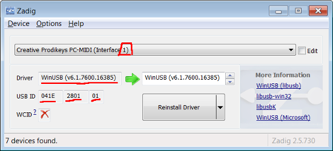

# Prodikeys64

Creative Prodikeys MIDI Interface driver for windows x64

This will allow you to use the Creative Prodikeys PC-MIDI USB keyboard on your modern windows (tested on win7 64bits, should work on win10 as well)

# Acknowledgments

This work has been made possible thanks to two main contributions :
- [VirtualMIDI SDK](https://www.tobias-erichsen.de/software/virtualmidi/virtualmidi-sdk.html) by Tobias Erichsen
- Linux prodikey_hid driver by Don Prince

# Features

## FN Key

FN Key will toggle an on/off state, with the F led indicator lighting up when fn_state is active.

## Top row function keys, from left to right

- Piano: Enable or disable midi interface (toggle midi_mode).

- Open web browser
    - When midi_mode active: sustain mode (press once to enable, one more time to disable)
    - When midi_mode active and fn_state active : sostenuto (press once to reenable with newly pressed piano keys)
 
- Open mail client
  - When midi_mode active: previous octave)
  - When midi_mode active and fn_state active : previous instrument

- Instant Messaging
  - When midi_mode inactive : (UNIMPLEMENTED)
  - When midi_mode active: next octave
  - When midi_mode active and fn_state active : next instrument

- Open calculator

- Calendar (UNIMPLEMENTED)

- Address book (UNIMPLEMENTED)

- Open My Documents folder

- Open My Pictures folder

- Open My Music folder

- Logout (UNIMPLEMENTED)

- Sleep mode

- Media Play/Pause

- Media Stop
  - When midi_mode active and fn_state active : switch to MIDI channel 0

- Media Previous Track
  - When midi_mode active and fn_state active : switch to previous MIDI channel (+1)

- Media Next Track
  - When midi_mode active and fn_state active : switch to next MIDI channel (-1)

- Media Eject (mapped to Media select)
  - When midi_mode active and fn_state active : switch to MIDI channel 9 (drums/percussions)

## Click wheel

- Left click wheel will function as volume up/down and mute
  - When midi_mode active and fn_state active : pitch wheel up/down and reset to base pitch
 
# Installation Instructions

Plug your Prodikeys keyboard in any usb port. Wait a bit for Windows to detect it and install the standard HidUsb driver.
Once it's done, the keyboard should work, but not the piano keys.

## WinUSB driver

WinUSB is a generic driver (Prodikeys descriptors are not compatible with windows' standard HID stack)
Zadig is an easy to use standalone tool (no installation required) to install WinUSB or other generic drivers on a selected USB device.

- Download latest [zadig](https://zadig.akeo.ie/) version.
- Run it
- In the topbar menu, select "Options -> List All Devices"
- Select "Creative Prodikeys PC-MIDI (Interface 1)"
- Select "WinUSB" driver
- Click on Replace driver

**Note** Replace driver only for Interface 1 (Interface 0 is the regular pc keyboard, which works perfectly well with HidUsb driver as you might have noticed)

Upon successful installation, it should look like this :

## teVirtualMIDI driver

Thanks to WinUSB driver we can now communicate with the Prodikeys keyboard, but we need another component to make it work like a MIDI peripheral.

- Download and install [loopMidi](http://www.tobias-erichsen.de/software/loopmidi.html) (or [teVirtualMIDI SDK](https://www.tobias-erichsen.de/wp-content/uploads/2020/01/teVirtualMIDISDKSetup_1_3_0_43.zip)) by Tobias Erichsen.
- During installation you will be prompted to install the midi driver. Please proceed.
- Once installed, in Win+X -> Device Manager you should be able to see the "teVirtualMIDI device"

## Prodikeys64

With both pre-requisites installed, you can now use Prodikeys64

- Download latest release or build it yourself.
- Extract and run prodikeys64.exe, this should give you a little piano icon system tray : 
 

- If you right click on it you can select "Activate Midi" (or you can also press the top left piano key on your prodikeys)

You should now be able to find and use "Prodikeys MIDI Interface" in your midi-compatible software (if you don't have one, see the next section about Synthesia)

## Using prodikeys with Synthesia

If you need something to test your prodikeys with, I recommend the excellent Synthesia piano learning app

- Download and install Synthesia ( https://synthesiagame.com/get?platform=win )
- Run Prodikeys64.exe and activate midi 
- Run Synthesia and navigate to the settings menu, you should see "Prodikeys MIDI Interface"

Click on it then click "Use input from this device", and finally press the first and last key of the piano to correctly set the 37-key range (you should see the keys you press turning green on the app, and hear them)

Congrats you can use your prodikeys with synthesia now :)

# Build Instructions

I use CLion with Visual Studio 2017 as the build toolchain.

For some reason only the Release version will compile (Debug version will raise a COFF building error).
